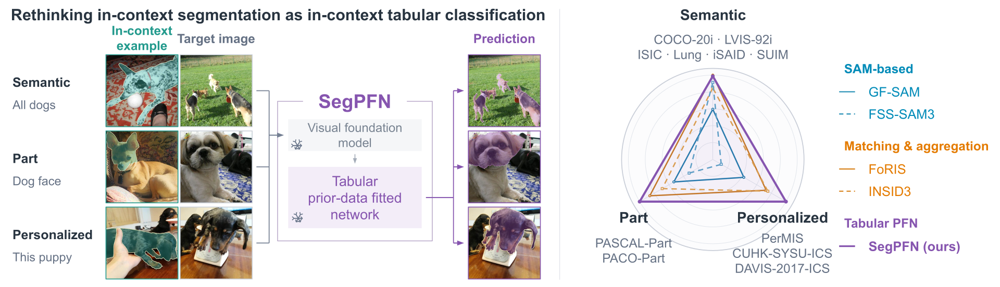
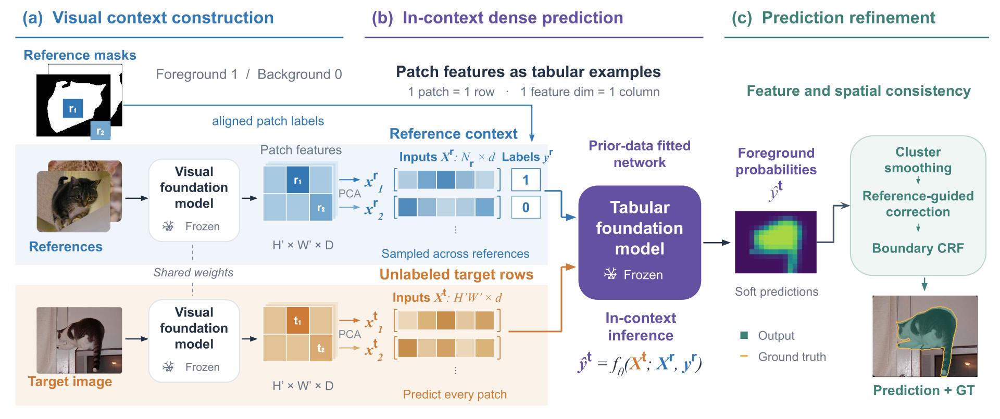

# SegPFN

**Training-Free In-Context Segmentation with Tabular Prior-Data Fitted Networks**

Jiajian Ma, Yihao Qiao, Ke Chen, Kaiyue Feng, Wushuang Rui, Abhishek Jha, Aarti Darji, and Yiqiu Shen<br>
New York University · NYU Langone Health

SegPFN uses one or a few annotated reference images to specify what to segment in a target image. A frozen DINOv3 encoder represents each patch as a row of visual features. Given foreground and background labels for the reference patches, a frozen TabPFN classifier predicts the target mask without segmentation-specific training.

[Get the datasets](#get-the-datasets) · [Run SegPFN](#quick-start) · [How it works](#how-it-works) · [Inference guide](docs/inference.md)



**Figure 1.** The reference annotation sets the scope of the task. It can ask for all dogs in a scene (semantic segmentation), a dog's face (part segmentation), or one particular puppy (personalized segmentation). The paper evaluates these three settings across 11 datasets.

## Get the datasets

**DAVIS-2017-ICS** contains 53 tasks from 20 videos. Changing the reference mask selects a different instance in the same frame pair. **CUHK-SYSU-ICS** contains 151 tasks from 113 image pairs. The reference mask selects the person to find in a second image.

Download the two source archives from their authors and keep them in the same folder.

- **DAVIS.** Get `DAVIS-2017-trainval-480p.zip` from the semi-supervised **TrainVal** section. It contains the video frames and instance masks. [Official DAVIS download page](https://davischallenge.org/davis2017/code.html) · [TrainVal 480p ZIP](https://data.vision.ee.ethz.ch/csergi/share/davis/DAVIS-2017-trainval-480p.zip)
- **CUHK-SYSU.** Request academic access from the dataset authors, then get `mask_images_json_sysu.zip` from the maskPS authors. Its annotation files contain the JPEGs and person polygons used in the paper. [Official CUHK-SYSU access instructions](https://github.com/ShuangLI59/person_search#experiments) · [Official maskPS download](https://github.com/Dingyuan-Zheng/maskPS#cuhk-sysu-dataset)

From the SegPFN repository root, run this command with the folder containing both ZIPs.

```bash
uv run benchmarks/get_datasets.py --source-dir ~/Downloads
```

The script builds both benchmarks under `data/` and verifies every image and mask against the paper’s checksums. SegPFN distributes the task lists, checksums, and reconstruction code. [Dataset instructions and terms](benchmarks/README.md)

## How it works



**Figure 2.** In this example, the reference masks mark the cat as foreground. The yellow outline on the final image shows the ground-truth boundary.

1. **Build the reference context.** A frozen DINOv3-L/16 encoder extracts patch features from every image. PCA fitted on the reference patches projects both reference and target features into the same space. The reference masks label sampled patches as foreground or background.
2. **Predict target patches.** A frozen TabPFN 3.5 classifier estimates a foreground probability for each target patch. With multiple references, labeled patches from all of them form a shared context.
3. **Refine the mask.** Cluster smoothing and reference-guided correction adjust the patch scores. A dense conditional random field (CRF) then refines the mask boundary.

## Quick start

### Install

Use Linux, Python 3.12, an NVIDIA GPU, a C++ compiler, and a CUDA toolkit matching your PyTorch build. The following commands use the CUDA 13.0 build. Run the CRF build on the target GPU or set `TORCH_CUDA_ARCH_LIST` to its compute capability.

```bash
git clone https://github.com/nyu-shenlab/SegPFN.git
cd SegPFN
python3.12 -m venv .venv
source .venv/bin/activate
python -m pip install -U pip setuptools wheel ninja
python -m pip install torch==2.13.0 torchvision==0.28.0 --index-url https://download.pytorch.org/whl/cu130
python -m pip install .
python scripts/install_crf.py
```

The CRF installer verifies the pinned upstream archive and builds its filtering extension against the active PyTorch installation. If `nvcc` is outside the default search path, set `CUDA_HOME` to the toolkit directory. For offline installation, pass the pinned zip to `scripts/install_crf.py --archive FILE`. [Dense CRF source](https://github.com/netw0rkf10w/CRF/tree/13a123f7cd3ea1f975e6c483b1e7c52112d7c151)

### Get the checkpoints

Obtain access to both model repositories through your Hugging Face account, then download the following revisions. The predictor checks the file hashes once at startup. Use `--weights DIR` if the downloads are outside `weights/`, keeping the same directory layout. [DINOv3-L/16](https://huggingface.co/facebook/dinov3-vitl16-pretrain-lvd1689m) · [TabPFN 3.5](https://huggingface.co/Prior-Labs/tabpfn_3_5)

```bash
hf auth login
hf download facebook/dinov3-vitl16-pretrain-lvd1689m config.json preprocessor_config.json model.safetensors \
  --revision ea8dc2863c51be0a264bab82070e3e8836b02d51 --local-dir weights/dinov3-large
hf download Prior-Labs/tabpfn_3_5 tabpfn-v3.5-20260909.safetensors \
  --revision 06bf2ba35c80a92a3b9abb436b99cf49e7a0365e --local-dir weights
```

### Predict

Run the example with the target image, reference image, and reference mask included in the checkout.

```bash
segpfn --query examples/query.png --reference examples/reference.png examples/reference-mask.png \
  --output outputs/mask.png
```

The command writes `outputs/mask.png` at the target image's original size, with foreground pixels set to 255 and background pixels to 0. For multiple references, repeat `--reference IMAGE MASK` once per pair. The same command is available through `python -m segpfn`.

## Reproducing a prediction

The inference guide covers indexed masks, refinement modes, and how to reuse a loaded model across queries. It also documents the patch sampling, runtime settings, and tests used to reproduce a prediction. [Masks and modes](docs/inference.md#reference-masks-and-refinement-modes) · [Python API](docs/inference.md#python-api) · [Reproducibility](docs/inference.md#reproducing-a-prediction)

## Upstream components

The seed construction and narrow-band CRF integration adapt FoRIS. The included 1024 × 500 positional basis was computed once from the DINOv3-L response to a constant image. Its SHA-256 is `6838d91c843bb59d72ccb458e58c82a9a7d705a60f8325fd97a876eae3fc8037` (compressed file). The corresponding license texts accompany the distribution. [FoRIS revision](https://github.com/Xi-Mu-Yu/FoRIS/tree/1aa02a11ef5f6673ed7a8a666ccf7d5586998d9e) · [FoRIS license](licenses/FoRIS-Apache-2.0.txt) · [DINOv3 license](licenses/DINOv3.txt)
